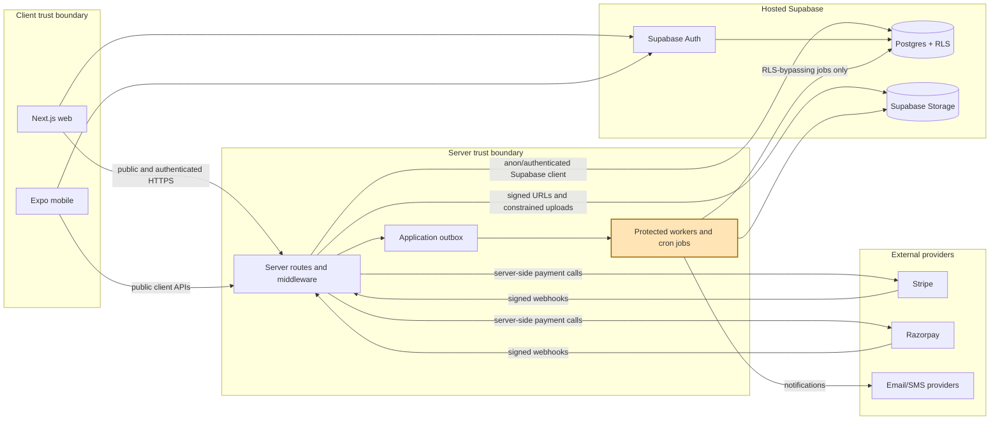

# CommunityHub architecture

The diagram shows the deployed trust boundaries and the asynchronous paths used
for notifications, payments, deletion, reconciliation, and delivery work.

## Trust boundary

`SUPABASE_SERVICE_ROLE_KEY` is allowed only inside the server trust boundary:
protected server routes and explicitly scoped workers/CI jobs. It may be used
for payment webhooks, deletion processing, reconciliation, outbox delivery,
and other documented service-only operations. It must never be present in web
browser code, Expo code, `NEXT_PUBLIC_*`, `EXPO_PUBLIC_*`, committed env files,
or logs.

Normal user requests use authenticated Supabase clients and are still subject
to RLS. Service-role access does not make a client request trusted; the route
must authenticate and authorize the caller before invoking a privileged
operation. See [ADR-0004](adr/0004-rls-authorization-boundary.md),
[ADR-0005](adr/0005-service-role-usage.md), and the
[RLS matrix](security/rls-matrix.md).

## Main data paths

- Auth and profiles use Supabase Auth and RLS-protected Postgres rows.
- Media uses Supabase Storage with signed, scoped access.
- Payment webhooks record provider events before idempotent processing; payment
  transactions remain the money-state source of truth.
- Application notifications are written to the outbox and delivered by workers,
  so provider outages do not roll back the triggering application action.
- Deletion, stock reconciliation, retention, and delivery operations run as
  separately scoped server workers.
